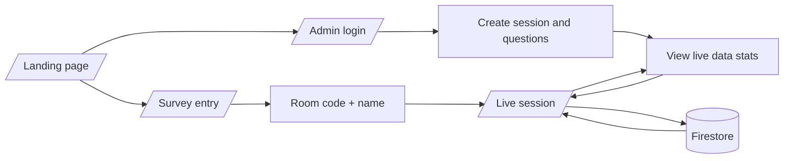

# Realtime Survey

A live survey room built with SvelteKit and Firestore. One side creates and controls the session, the other joins with a room code and answers the current question in real time.

## At a Glance

- Fast landing page with clear paths for participants and admins.
- Real-time question delivery through Firestore snapshots.
- Multiple question types: labeled choices, yes/no, and 1-10 ratings.
- Admin session controls for creating questions, rotating the active prompt, and reading response stats.
- Lightweight browser state with `sessionStorage` so participants can pick up where they left off in the same session.

## Flow



## Stack

- SvelteKit 2 with Svelte 5 runes mode enabled.
- Vite plus Tailwind CSS 4 for the UI.
- Firebase client SDK for auth and Firestore.
- `firebase-admin` is present in the project, but the current app behavior is driven by the client SDK.

## Routes

- `/` — the main landing page.
- `/survey` — participant sign-in screen for name and room code.
- `/survey/[session]` — live response experience tied to a specific session.
- `/admin` — password-protected admin workspace.

## Data Model

Firestore data is organized like this:

- `sessions` — the session records themselves.
- `sessions/{sessionId}/questions` — questions for a session.
- `sessions/{sessionId}/responses` — submitted answers from participants.

Each session keeps the active question ID, a generated session name, and timestamps. Questions can be labeled choice lists, yes/no prompts, or rating sliders from 1 to 10.

## Setup

1. Copy `.env.example` to `.env`.
2. Fill in the Firebase values from your project.
3. Set a strong `PUBLIC_ADMIN_PASSWORD` for the admin gate.
4. Install dependencies with `bun install`.

Required environment variables:

- `PUBLIC_FIREBASE_API_KEY`
- `PUBLIC_FIREBASE_AUTH_DOMAIN`
- `PUBLIC_FIREBASE_PROJECT_ID`
- `PUBLIC_FIREBASE_STORAGE_BUCKET`
- `PUBLIC_FIREBASE_SENDER_ID`
- `PUBLIC_FIREBASE_APP_ID`
- `PUBLIC_FIREBASE_MEASUREMENT_ID`
- `PUBLIC_ADMIN_PASSWORD`

The Firebase settings must stay prefixed with `PUBLIC_` so SvelteKit can expose them to the client.

## Run It

```sh
bun run dev
```

Open the app in a browser automatically:

```sh
bun run dev -- --open
```

Build for production:

```sh
bun run build
```

Preview the production build:

```sh
bun run preview
```

## Commands

- `bun run dev` — start the local Vite development server.
- `bun run build` — create a production build.
- `bun run preview` — preview the production bundle locally.
- `bun run lint` — check formatting with Prettier.
- `bun run format` — format the project with Prettier.

## Notes

- The app stores the current participant name, room code, and admin login state in `sessionStorage`.
- Answers are written to Firestore as the session runs, so the admin and participant views stay synchronized without page refreshes.